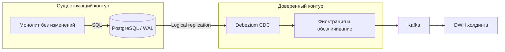
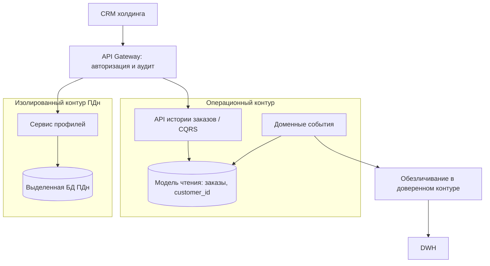
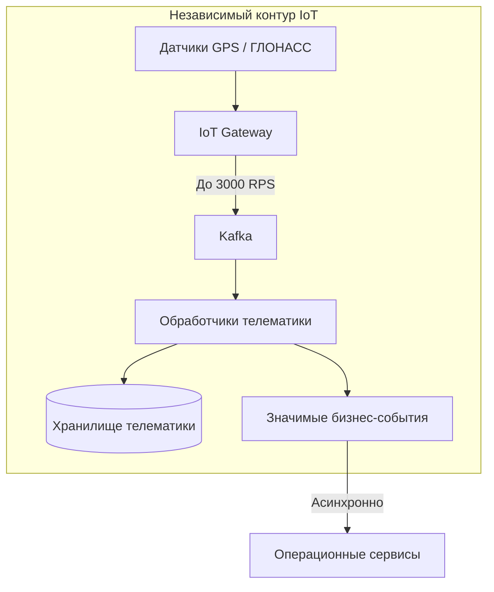

# Отработка потенциальных возражений стейкхолдеров Fast Cargo

## 1. Возражение техлида Fast Cargo - интеграция DWH

> «Временное решение для DWH создаст риски для стабильности текущих отгрузок и потребует переписывания легаси-кода».

**Обоснованность опасения:** высокая. Общая PostgreSQL уже является единой точкой отказа, а тяжёлые отчёты мешают транзакционным операциям. Промежуточное решение должно быть внедрено за три месяца без изменений исходного кода монолита и дополнительной SELECT-нагрузки на рабочую БД.

### Архитектурное решение

CDC на основе журнала транзакций PostgreSQL с помощью Debezium и Kafka.

| Механизм | Как снижает риск |
|---|---|
| CDC через WAL | Исключает регулярный опрос бизнес-таблиц |
| Отключение первоначального snapshot бизнес-таблиц рабочей БД | Исключает массовое чтение таблиц при запуске |
| Kafka | Разрывает зависимость доступности DWH и монолита |
| Мониторинг replication slot и свободного диска | Снижает риск неконтролируемого накопления WAL |
| Фильтрация изменений | Ограничивает объём передаваемых данных |
| Независимое развёртывание CDC | Позволяет остановить интеграцию без остановки логистики; остановка должна сопровождаться контролем удержания WAL |
| Нагрузочное тестирование | Проверяет дополнительные затраты CPU, диска и сети |

### Ответ стейкхолдеру

Предлагаемое решение не требует изменения исходного кода монолита и дополнительных SELECT-запросов к его бизнес-таблицам. Изменения будут получаться непосредственно из журнала транзакций PostgreSQL.

Интеграция с DWH будет асинхронной. При недоступности DWH события будут накапливаться в Kafka в пределах настроенного срока хранения и доступной ёмкости.

CDC создаёт дополнительную ресурсную нагрузку и риск накопления WAL. До запуска проведём нагрузочные испытания, настроим мониторинг и определим условия безопасного отключения интеграции, включая управление replication slot и последующее восстановление потока.

Kafka и интеграция с DWH сохранятся в целевой архитектуре, а источником событий вместо легаси-СУБД станут доменные микросервисы через Transactional Outbox. Переходное решение не является полностью одноразовым.

### Критерии приёмки

| Метрика | Целевое значение |
|---|---|
| Изменения исходного кода монолита | 0 |
| Дополнительные SELECT к бизнес-таблицам рабочей БД | 0 |
| Задержка доставки ключевых статусов в DWH | ≤ 5 секунд |
| Доступность ядра | ≥ 99,95% |
| Деградация операционных процессов | В пределах согласованного бюджета производительности |

Первоначальная загрузка исторических данных, если необходима, выполняется из резервной копии или отдельного восстановленного экземпляра с согласованной границей перехода к потоку CDC. Возможность настройки logical replication и необходимые служебные запросы коннектора подлежат отдельной проверке: отсутствие SELECT к бизнес-таблицам не означает нулевой нагрузки на PostgreSQL.

## 2. Возражение департамента ИБ — интеграция CRM

> «Интеграция CRM нарушает требования 152-ФЗ, так как персональные данные лежат в общем контуре монолита».

**Обоснованность опасения:** высокая. Текущая архитектура не обеспечивает требуемой кейсом физической изоляции ПДн. Прямой доступ внешних систем к транзакционной БД запрещён.

### Архитектурное решение

Выделение отдельного сервиса профилей и физически изолированного хранилища персональных данных.

| Механизм | Как снижает риск |
|---|---|
| Выделенный сервис профилей | Централизует обработку ПДн |
| Физически изолированная СУБД | Разделяет персональные и операционные данные |
| UUID клиента | Позволяет связывать бизнес-сущности без дублирования паспортных и контактных данных |
| RBAC и авторизация сервисов | Ограничивает доступ к ПДн |
| Шифрование данных и каналов | Снижает риск компрометации |
| Аудит обращений | Обеспечивает контролируемость доступа |
| Обезличивание аналитических данных | Снижает риск идентификации клиентов в DWH |
| Очистка логов, кешей и событий | Предотвращает неявное распространение ПДн |

### Ответ стейкхолдеру

Подключение CRM непосредственно к существующей базе монолита недопустимо. Интеграция предусматривается только через контролируемые API.

В целевой архитектуре ПДн будут вынесены в отдельный физически изолированный контур. Операционные сервисы будут использовать идентификатор клиента, не дублируя паспортные и контактные данные.

CRM будет получать историю заказов через отдельную модель чтения, а ПДн — через защищённый API сервиса профилей при наличии соответствующих полномочий и правовых оснований.

Перед промышленным подключением CRM проверим потоки данных, авторизацию, журналирование, остаточные копии ПДн и обезличивание аналитических данных. Подключение возможно только после согласования с ИБ.

### Критерии приёмки

| Метрика | Целевое значение |
|---|---|
| Прямые подключения CRM к транзакционным СУБД | 0 |
| Передача необезличенных ПДн в DWH | 0 |
| Хранение паспортных и контактных данных в операционных БД после миграции | 0 |
| Аудит обращений к сервису профилей | 100% |
| Выявленные несанкционированные доступы по результатам проверок | 0 |

Замена ПДн на UUID сама по себе не гарантирует юридического обезличивания: необходимо учитывать обратную идентификацию через историю заказов, адреса и геоданные. Окончательное соответствие 152-ФЗ и применимым стандартам подтверждается ИБ и юридическим подразделением.

## 3. Возражение производственно-инфраструктурного департамента — IoT

> «Поток телематики IoT на 3000 RPS создаст цунами данных и мгновенно уронит текущую инфраструктуру и СУБД».

**Обоснованность опасения:** высокая для AS-IS. Запись координат зависит от общей PostgreSQL. Отказ или плановые работы склада и биллинга не должны приводить к потере геоданных либо замедлению создания заказов.

### Архитектурное решение

Независимый контур приёма, обработки и хранения телеметрии.

### Предварительная оценка нагрузки

Размер события, длительность пика и retention отсутствуют в исходных требованиях. Ниже приведён расчётный пример, а не утверждённая конфигурация.

| Параметр | Значение |
|---|---|
| Пиковая интенсивность (требование) | 3000 событий/с |
| Размер события (допущение) | 500 байт |
| Длительность пика (допущение) | 24 ч/сутки |
| Retention Kafka (допущение) | 7 суток |
| Replication factor (допущение) | 3 |
| Событий в сутки | 259,2 млн |
| Входящий поток | 1,5 МБ/с |
| Сырые данные в сутки | 129,6 ГБ |
| Диск Kafka с репликацией | 2,7216 ТБ |

Формулы (десятичные единицы):

- Событий в сутки = RPS × часы нагрузки × 3600.
- Входящий поток, МБ/с = RPS × размер события / 10^6.
- Объём в сутки, ГБ = событий в сутки × размер события / 10^9.
- Диск Kafka, ТБ = объём в сутки × retention × replication factor / 1000.

Не учитываются компрессия, служебные данные, индексы, запас диска и отдельное хранилище телематики. При нагрузке вне пикового окна её также следует учитывать в итоговом расчёте.

| Механизм | Как снижает риск |
|---|---|
| Выделенный IoT Gateway | Исключает конкуренцию с API создания заказов на уровне приложения |
| Kafka | Буферизует события при недоступности обработчиков |
| Партиционирование по идентификатору устройства | Поддерживает параллельную обработку и порядок внутри партиции |
| Пакетная запись | Сокращает количество отдельных операций записи в СУБД |
| Выделенное хранилище | Исключает конкуренцию с операционными транзакциями |
| Изоляция вычислительных, сетевых и дисковых ресурсов | Снижает влияние IoT на другие домены |
| Retention и агрегация | Ограничивают рост объёма данных |
| Буферизация на устройствах, подтверждение надёжной записи и повторная доставка | Снижают риск потерь при временных отказах |

### Ответ стейкхолдеру

Мы не предлагаем направлять поток телематики в текущий монолит и его СУБД. Для IoT создаётся отдельный контур со своими точками приёма, брокером, обработчиками и хранилищем. В операционные сервисы передаются только значимые бизнес-события, а не весь поток координат.

При временной недоступности хранилища данные накапливаются в брокере в пределах его ёмкости и retention. После восстановления обработчики должны иметь достаточный запас производительности для разбора накопившейся очереди. При недоступности точки приёма потребуется буферизация на устройствах.

Ресурсы IoT рассчитываются отдельно от операционного ядра. До промышленного запуска проведём нагрузочное тестирование при 3000 RPS телематики и одновременном создании заказов с интенсивностью 200 RPS, включая отказы склада, биллинга и хранилища телематики.

### Критерии приёмки

| Метрика | Целевое значение |
|---|---|
| Пиковая интенсивность приёма телематики | 3000 RPS |
| Одновременная интенсивность создания заказов | 200 RPS |
| Доступность операционного ядра | ≥ 99,95% |
| Запись сырых данных телематики в операционные БД | 0 |
| Потеря принятых событий при отказе склада или биллинга | 0 |
| Деградация создания заказов при пиковой нагрузке IoT | В пределах согласованных НФТ |
| Восстановление обработки после отказа | В пределах согласованного RTO |

## 4. Сводная позиция для архитектурной защиты

| Опасение | Архитектурный принцип | Решение | Ожидаемый результат |
|---|---|---|---|
| DWH нарушит работу монолита | Минимизация вмешательства в Legacy | CDC + Kafka | Интеграция без изменения исходного кода |
| CRM приведёт к утечке ПДн | Изоляция данных и границ доверия | Выделенный сервис профилей | Контролируемый доступ к ПДн |
| IoT перегрузит инфраструктуру | Изоляция нагрузки и отказов | Независимый потоковый контур | Независимое масштабирование телематики |

Общий принцип трансформации — разделение системы по бизнес-доменам, профилям нагрузки и границам безопасности, а не просто декомпозиция монолита.
